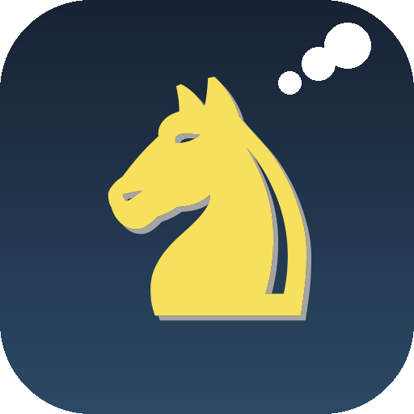
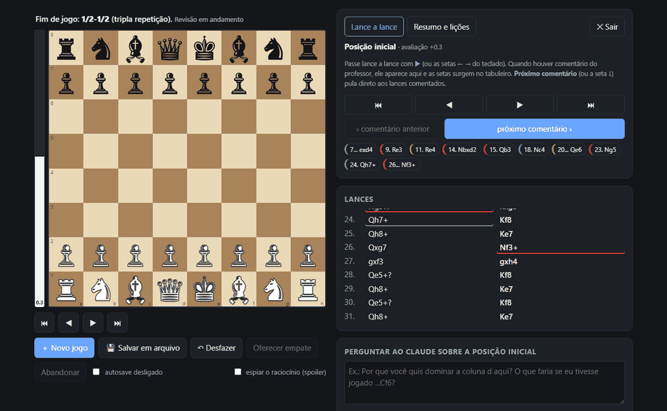
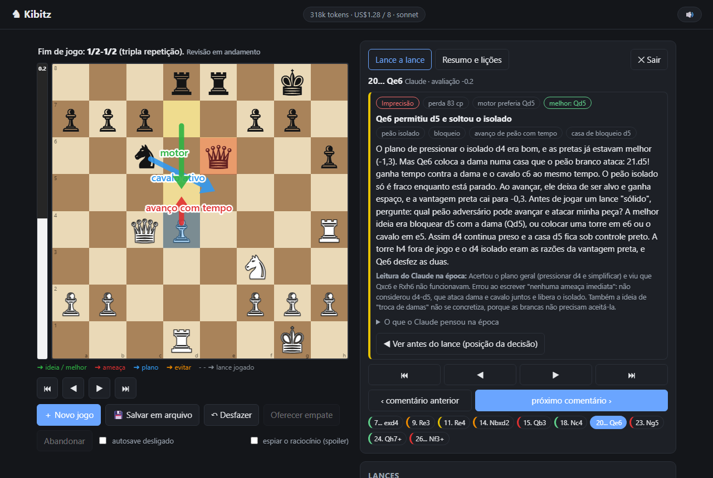
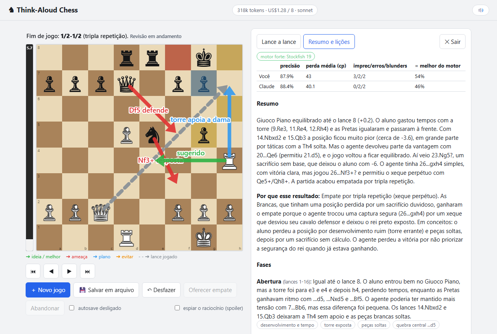
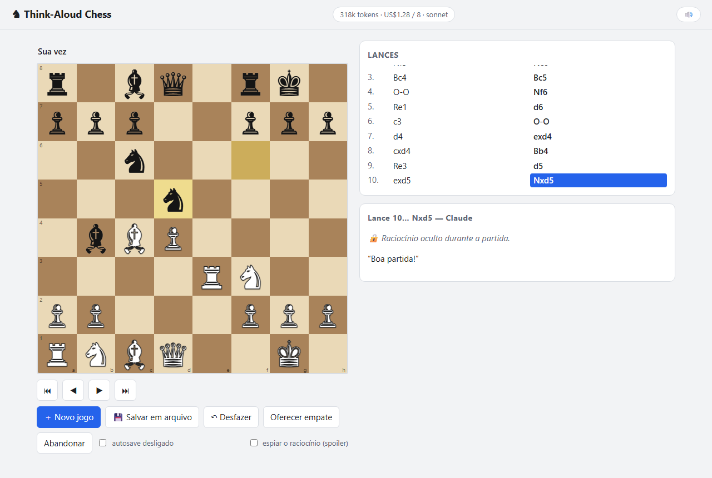
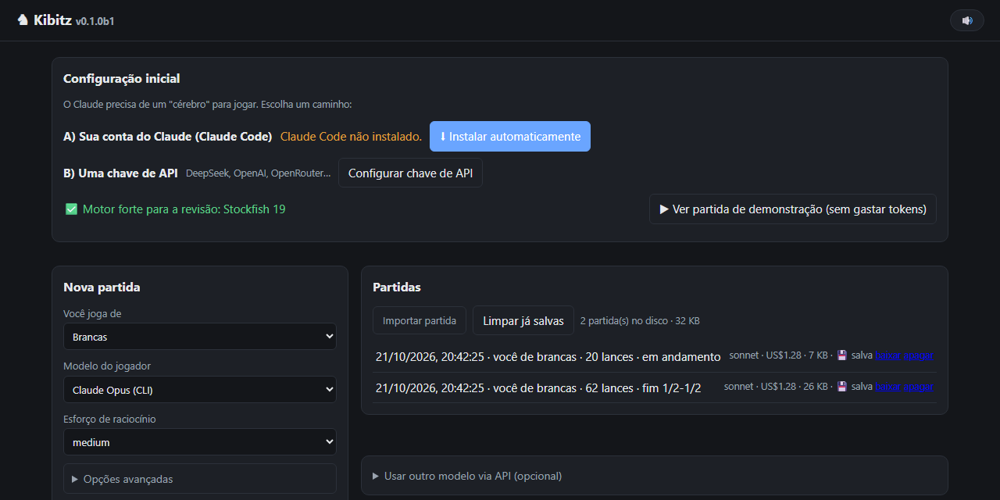
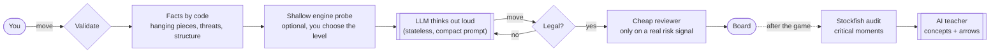

<div align="center">



# Think-Aloud Chess

**Play chess against an LLM that thinks out loud — then let it teach you.**

[](https://github.com/Andrade020/think-aloud-chess/releases)
[](https://github.com/Andrade020/think-aloud-chess/actions/workflows/ci.yml)
[](LICENSE)


[**⬇ Download for Windows**](https://github.com/Andrade020/think-aloud-chess/releases/download/v0.1.0-beta.1/ThinkAloudChess-0.1.0-beta.1-Setup.exe) · [Português](README.pt-BR.md) · [How it works](docs/ARCHITECTURE.md)



</div>

> **Beta.** It works end to end and has a test suite, but the interface is currently **Portuguese-only** and the Windows installer is **not code-signed yet** (see [Install](#install)).

## Why

Engines like Stockfish tell you *what* is best, but not *why* in human terms — "I wanted the seventh rank and to trap the king" is a concept, not a search tree. A language model can play by intuition and explain itself in those concepts. The catch: LLMs are good in the opening and bad later, they hallucinate illegal moves, and an engine hint can turn their "explanation" into a justification invented after the fact.

Think-Aloud Chess is a **fair, auditable way to play against an LLM and learn from it**:

- the model **thinks out loud** every move — read the position, threats, plan, candidates, blunder check — and everything is saved;
- every move is **validated** against the legal moves; objective facts (hanging pieces, threats) are computed by code, so the model doesn't have to "see" the board from memory;
- **you control how much engine help it gets** — and a hidden engine audits whether it really reasons or just rationalizes the engine's choice;
- afterwards an **AI teacher** (with Stockfish as ground truth) reviews the game, chess.com-style, explaining mistakes **by concepts** and drawing arrows.

## Features

| | |
|---|---|
| 🧠 **Layered reasoning** | Position → threats → plan → candidates → decision → blunder check, in natural language. Each move keeps its full reasoning (hidden until the game ends, so it's fair). |
| 🛡️ **No hallucinated moves** | Moves are checked against the legal list (3 retries, then fallback). Facts come from code. An optional cheap reviewer model (Haiku) double-checks risky moves — quietly, only when there's a real signal. |
| ⚖️ **Adjustable engine help** | *Full* (material + position, ranked) to learn from it · *Material only* (captures/checks, no ranking) · *None* (pure reasoning). A hidden shallow engine audits the model's agreement with it. |
| 🎓 **AI teacher review** | Opt-in. Stockfish evaluates the game, picks the critical moments, and the teacher explains each one by concepts, including where **Claude's own reading was wrong**. Arrows, highlighted squares, evaluation bar, "next comment" button. |
| 📊 **Game audit** | Accuracy, average loss, inaccuracies/mistakes/blunders for both sides, and an agreement-with-engine metric. |
| 💸 **Token-aware** | Each move is stateless (cost doesn't grow with the game), with a soft budget per game and a quiet reviewer. |
| 🔌 **Bring your own brain** | Your **Claude Code** account, or any **OpenAI-compatible API** (DeepSeek, OpenAI, OpenRouter, Groq, Ollama…). |
| 💾 **Your games, your files** | Compact `.gz` export/import, readable Markdown autosave, undo, sounds, 100% local. |

<table>
<tr>
<td width="50%"><br><sub><b>Review mode</b> — comments and arrows appear as you step through the game.</sub></td>
<td width="50%"><br><sub><b>Summary &amp; lessons</b> — phases, concepts, and practice exercises.</sub></td>
</tr>
<tr>
<td><br><sub><b>Fair play</b> — the model's reasoning is locked until the game ends.</sub></td>
<td><br><sub><b>First-run assistant</b> — installs Claude Code, signs you in, or takes an API key.</sub></td>
</tr>
</table>

## Install

### Windows (recommended)

1. Download **`ThinkAloudChess-<version>-Setup.exe`** from the [Releases page](https://github.com/Andrade020/think-aloud-chess/releases).
2. Run it. No administrator rights needed; Python and Stockfish are bundled.
3. Open **Think-Aloud Chess**. A first-run assistant helps you connect a "brain" (your Claude account, or an API key). You can also open the **demo game** — a finished game with a full AI review — without spending a single token.

> **"Windows protected your PC"?** The beta installer is not code-signed yet (signing certificates cost money and need identity verification), so SmartScreen shows *Unknown publisher*. Click **More info → Run anyway**. You can verify the download against the published `.sha256`, read every line of the source, and the installer is built in the open by [`installer/`](installer). Plans to sign it are in [docs/SIGNING.md](docs/SIGNING.md).

### macOS / Linux / from source

```bash
pipx install git+https://github.com/Andrade020/think-aloud-chess.git   # or: pip install .
think-aloud-chess            # opens http://127.0.0.1:5000
```

Requirements: Python 3.10+. For the model you need **either** [Claude Code](https://claude.com/claude-code) (run `claude` once to sign in) **or** an API key for any OpenAI-compatible provider (configure it in the app). Stockfish is optional but recommended for the teacher review (`winget install Stockfish.Stockfish`, `brew install stockfish`, `apt install stockfish`).

## How it works



**Fairness by design.** The model gets no tools and no engine unless you allow a *shallow, labeled* hint. Its reasoning stays hidden until the game ends. Every move records whether it matched the hidden engine's best move, so you can measure whether the "explanations" are the model's own or rationalizations of an engine hint. See [docs/ARCHITECTURE.md](docs/ARCHITECTURE.md).

## Settings that matter

| Setting | What it does |
|---|---|
| **Engine help** | *Full* (ranked hints) · *Material only* (captures/checks, unranked) · *None*. Plus an optional switch for the objective "facts" block. |
| **Effort** | Reasoning effort of the player model. The main driver of cost and time. |
| **Reviewer** | A cheap model that double-checks a move only on a real signal (new piece at risk, mate threat, big engine disagreement). |
| **Soft budget** | Past the budget the game drops to low effort and silences the reviewer. |

## Your data and privacy

Everything is local. Games, autosaves and `config.json` (API keys) live in your data folder — `%LOCALAPPDATA%\ThinkAloudChess` on Windows, or `./data` when running from a clone. Keys never go into games, exports or the browser. The app contacts only the model provider **you** configure (and winget, only when you ask it to install Claude Code). No telemetry. See [SECURITY.md](SECURITY.md).

## Known limitations (beta)

- UI text is Portuguese only; i18n is planned. The README and docs are bilingual.
- One human vs one LLM; no clock, no opening book, no endgame tablebases (by design).
- The in-game shallow engine is 3-ply; only the *post-game* teacher uses Stockfish.
- Windows installer is unsigned; macOS/Linux have no installer yet (use `pipx`).
- Rating estimates are intentionally **not** shown: a handful of games and a shallow ruler can't support them.

## Development

```bash
git clone https://github.com/Andrade020/think-aloud-chess && cd think-aloud-chess
pip install -e ".[dev]" && pytest          # 26 tests, no network, no tokens
python -m think_aloud_chess                # run from the clone (data in ./data)
powershell -File installer/build_windows.ps1   # build the Windows installer
python tools/make_media.py                 # regenerate the README screenshots
```

Contributions are welcome — see [CONTRIBUTING.md](CONTRIBUTING.md). Good first areas: English UI strings (i18n), macOS/Linux packaging, accessibility, more teaching prompts.

## License and credits

[GPL-3.0-or-later](LICENSE). Built on [python-chess](https://github.com/niklasf/python-chess) (GPL-3.0+), [Flask](https://flask.palletsprojects.com/) (BSD-3) and [Stockfish](https://github.com/official-stockfish/Stockfish) (GPLv3, bundled in the installer). Not affiliated with Anthropic; "Claude" is a trademark of Anthropic.
