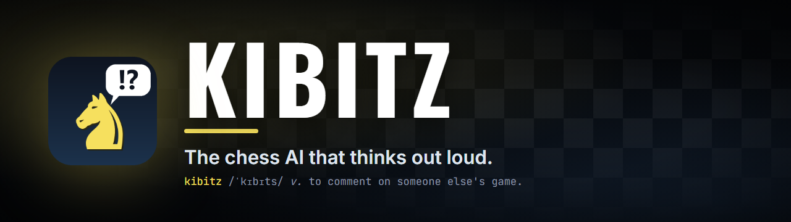
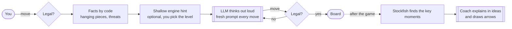

<div align="center">



[](https://github.com/Andrade020/kibitz/releases)
[](https://github.com/Andrade020/kibitz/actions/workflows/ci.yml)
[](LICENSE)

**[Download for Windows](https://github.com/Andrade020/kibitz/releases)** &nbsp;·&nbsp; [Português](README.pt-BR.md) &nbsp;·&nbsp; [How it works](docs/ARCHITECTURE.md)


</div>

**Kibitz plays chess against you the way a person does: it reads the board, weighs your threats, makes a plan and tells you what it is thinking. When the game ends it turns into a coach and walks you through it, with arrows, ideas and the truth from Stockfish.**

> **Beta.** It works from start to finish, but the interface is in Portuguese for now and the Windows installer isn't code-signed yet (details [below](#get-it)).

## Why it exists

Ask a chatbot for a game of chess and around move fifteen the knight jumps over its own rook. Ask an engine why it played a move and you get a number. Kibitz tries to be the thing in between: an opponent that plays legal, human-sounding chess, and a teacher that explains the game in ideas (the center, a weak pawn, an open file) instead of search trees.

Two bets make it work.

**Never ask the model to remember the board.** Every move it gets the whole position again, the list of legal moves, and a few facts computed by code: which pieces hang, what you are threatening. A chatbot that has to rebuild the board from a list of moves drifts. One that is simply shown the board doesn't.

**Never let an explanation be invented.** The coach is handed the truth by Stockfish and has to say so when a move is just calculation and not a concept. Every move and every arrow it suggests is checked before you see it.

## How a game feels

<table>
<tr>
<td width="50%" valign="top"></td>
<td width="50%" valign="top"><h3>It thinks out loud.</h3>Each move comes with a reading of the position, the threats it sees, a plan and a blunder check, all saved. During the game that reasoning stays locked, so neither of you can peek. When the game ends, it opens.</td>
</tr>
<tr>
<td width="50%" valign="top"><h3>Then it kibitzes.</h3>Press <b>Start review</b> and step through the game. On the moves that mattered, a comment and arrows show up by themselves; <i>next comment</i> jumps to the following one. <i>See before the move</i> shows the position where the decision was made.</td>
<td width="50%" valign="top"></td>
</tr>
<tr>
<td width="50%" valign="top"></td>
<td width="50%" valign="top"><h3>Fair, and yours.</h3>Choose how much engine help the AI gets, down to none. Use your Claude account or any OpenAI-compatible API (DeepSeek, OpenAI, OpenRouter, Ollama). Games, keys and notes stay on your computer. A first-run assistant sets it all up, and a <b>demo game</b> lets you try the review without spending a token.</td>
</tr>
</table>

## Get it

### Windows

1. Download **`Kibitz-<version>-Setup.exe`** from the [Releases page](https://github.com/Andrade020/kibitz/releases).
2. Run it. No administrator rights needed; Python and Stockfish come bundled.
3. Open **Kibitz**. A first-run assistant connects the AI (your Claude account, or an API key). Or just open the demo game.

> **"Windows protected your PC"?** The beta installer isn't code-signed (certificates cost money and need identity verification), so SmartScreen says *Unknown publisher*. Click **More info, then Run anyway**. Check the download against the published `.sha256`, read the source, or see how the build is done and attested in [`installer/`](installer). Signing plans: [docs/SIGNING.md](docs/SIGNING.md).

### macOS and Linux

```bash
pipx install git+https://github.com/Andrade020/kibitz.git     # or: pip install .
kibitz                                                          # opens http://127.0.0.1:5000
```

You need Python 3.10+, plus **either** [Claude Code](https://claude.com/claude-code) (run `claude` once to sign in) **or** an API key for an OpenAI-compatible provider (set it up inside the app). Stockfish is optional but makes the coach much better: `brew install stockfish`, `apt install stockfish` or `winget install Stockfish.Stockfish`.

## Under the hood



The AI gets no tools and no engine unless you allow a shallow, clearly labeled hint. Every move records whether it matched the hidden engine's choice, so you can tell reasoning from rationalizing. The full story is in [docs/ARCHITECTURE.md](docs/ARCHITECTURE.md).

## Your data

Everything is local. Games, autosaves and `config.json` (API keys) live in `%LOCALAPPDATA%\Kibitz` on Windows, or `./data` when you run from a clone. Keys never go into games, exports or the browser. The app talks only to the model provider you configure, plus winget when you ask it to install Claude Code. No telemetry. See [SECURITY.md](SECURITY.md).

## What it won't do (yet)

- Speak English in the UI. Text is Portuguese for now; i18n is on the list. README and docs are bilingual.
- Play with a clock, an opening book or tablebases. That's on purpose.
- Use Stockfish *during* the game. Only the coach does, after the last move.
- Estimate your rating. A few games and a shallow ruler can't support one, so it doesn't pretend.
- Ship signed or for macOS/Linux as an installer. Those are next.

## Hack on it

```bash
git clone https://github.com/Andrade020/kibitz && cd kibitz
pip install -e ".[dev]" && pytest         # no network, no tokens
python -m kibitz                          # runs from the clone, data in ./data
powershell -File installer/build_windows.ps1   # builds the Windows installer
```

Contributions are welcome: see [CONTRIBUTING.md](CONTRIBUTING.md). Good places to start are English UI strings, macOS/Linux packaging and better teaching prompts.

## License

[GPL-3.0-or-later](LICENSE). Built on [python-chess](https://github.com/niklasf/python-chess) (GPL-3.0+), [Flask](https://flask.palletsprojects.com/) (BSD-3) and [Stockfish](https://github.com/official-stockfish/Stockfish) (GPLv3, bundled in the installer). Not affiliated with Anthropic; "Claude" is a trademark of Anthropic.
