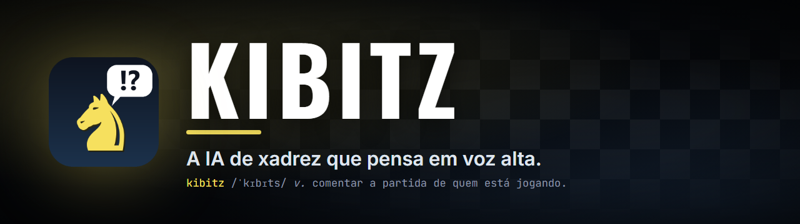
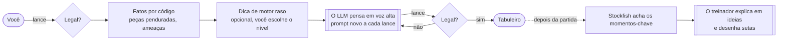

<div align="center">



[](https://github.com/Andrade020/kibitz/releases)
[](https://github.com/Andrade020/kibitz/actions/workflows/ci.yml)
[](LICENSE)

**[Baixar para Windows](https://github.com/Andrade020/kibitz/releases)** &nbsp;·&nbsp; [English](README.md) &nbsp;·&nbsp; [Como funciona](docs/ARCHITECTURE.md)


</div>

**O Kibitz joga xadrez contra você do jeito que uma pessoa joga: lê o tabuleiro, pesa suas ameaças, faz um plano e conta o que está pensando. Quando a partida acaba, ele vira treinador e conduz você pelo jogo, com setas, ideias e a verdade do Stockfish.**

> **Beta.** Funciona do começo ao fim. O instalador do Windows ainda não tem assinatura digital (detalhes [abaixo](#instalação)).

## Por que isso existe

Peça uma partida de xadrez a um chatbot e, por volta do lance 15, o cavalo pula por cima da própria torre. Pergunte a um motor por que ele fez um lance e você recebe um número. O Kibitz tenta ser o que fica no meio: um adversário que joga xadrez legal e com cara de gente, e um professor que explica o jogo em ideias (o centro, um peão fraco, uma coluna aberta) e não em árvores de busca.

Duas apostas fazem isso funcionar.

**Nunca pedir ao modelo que lembre do tabuleiro.** A cada lance ele recebe a posição inteira de novo, a lista de lances legais e alguns fatos calculados por código: quais peças estão penduradas, o que você está ameaçando. Um chatbot que precisa reconstruir o tabuleiro a partir de uma lista de lances se perde. Um que simplesmente *vê* o tabuleiro, não.

**Nunca deixar uma explicação ser inventada.** O treinador recebe a verdade do Stockfish e precisa admitir quando um lance é só cálculo e não um conceito. Cada lance e cada seta que ele sugere é conferido antes de chegar até você.

## Como é jogar

<table>
<tr>
<td width="50%" valign="top"></td>
<td width="50%" valign="top"><h3>Ela pensa em voz alta.</h3>Cada lance vem com uma leitura da posição, as ameaças que ela vê, um plano e uma checagem anti-erro, tudo salvo. Durante a partida esse raciocínio fica trancado, e nenhum dos dois pode espiar. Quando a partida acaba, ele se abre.</td>
</tr>
<tr>
<td width="50%" valign="top"><h3>Depois, ela kibitza.</h3>Aperte <b>Começar a revisão</b> e passe pela partida. Nos lances que importaram, um comentário e as setas aparecem sozinhos; <i>próximo comentário</i> pula para o seguinte. <i>Ver antes do lance</i> mostra a posição em que a decisão foi tomada.</td>
<td width="50%" valign="top"></td>
</tr>
<tr>
<td width="50%" valign="top"></td>
<td width="50%" valign="top"><h3>Justo, e seu.</h3>Escolha quanta ajuda de motor a IA recebe, até nenhuma. Use sua conta do Claude ou qualquer API compatível com OpenAI (DeepSeek, OpenAI, OpenRouter, Ollama). Partidas, chaves e anotações ficam no seu computador. Um assistente configura tudo na primeira abertura, e uma <b>partida de demonstração</b> deixa você testar a revisão sem gastar um token.</td>
</tr>
</table>

## Instalação

### Windows

1. Baixe o **`Kibitz-<versão>-Setup.exe`** na [página de Releases](https://github.com/Andrade020/kibitz/releases).
2. Execute. Não precisa de administrador, e o Python e o Stockfish já vêm junto.
3. Abra o **Kibitz**. Um assistente conecta a IA (sua conta do Claude ou uma chave de API). Ou abra direto a partida de demonstração.

> **"O Windows protegeu o computador"?** O instalador beta não é assinado digitalmente (certificados custam dinheiro e exigem verificação de identidade), então o SmartScreen mostra *Editor desconhecido*. Clique em **Mais informações e depois em Executar assim mesmo**. Confira o download com o `.sha256` publicado, leia o código ou veja como o build é feito e atestado em [`installer/`](installer). Planos de assinatura: [docs/SIGNING.md](docs/SIGNING.md).

### macOS e Linux

```bash
pipx install git+https://github.com/Andrade020/kibitz.git     # ou: pip install .
kibitz                                                          # abre http://127.0.0.1:5000
```

Você precisa do Python 3.10+, mais **ou** o [Claude Code](https://claude.com/claude-code) (rode `claude` uma vez para entrar) **ou** uma chave de API de um provedor compatível com OpenAI (configurada dentro do app). O Stockfish é opcional, mas melhora muito o treinador: `brew install stockfish`, `apt install stockfish` ou `winget install Stockfish.Stockfish`.

## Por dentro



A IA não recebe ferramentas nem motor, a não ser que você permita uma dica rasa e claramente rotulada. Cada lance registra se coincidiu com a escolha do motor escondido, para você distinguir raciocínio de racionalização. A história completa está em [docs/ARCHITECTURE.md](docs/ARCHITECTURE.md).

## Seus dados

Tudo é local. Partidas, autosaves e o `config.json` (chaves de API) ficam em `%LOCALAPPDATA%\Kibitz` no Windows, ou em `./data` ao rodar de um clone. As chaves nunca vão para partidas, arquivos exportados nem para o navegador. O app só fala com o provedor de modelo que você configurar, mais o winget quando você pede para instalar o Claude Code. Sem telemetria. Veja [SECURITY.md](SECURITY.md).

## O que ele ainda não faz

- Falar inglês na interface. O texto está em português por enquanto; a internacionalização está na lista. README e docs são bilíngues.
- Jogar com relógio, livro de aberturas ou tablebases. É de propósito.
- Usar o Stockfish *durante* a partida. Só o treinador usa, depois do último lance.
- Estimar o seu rating. Poucas partidas e uma régua rasa não sustentam um número, então ele não finge.
- Vir assinado ou com instalador para macOS e Linux. Esses são os próximos passos.

## Mexa no código

```bash
git clone https://github.com/Andrade020/kibitz && cd kibitz
pip install -e ".[dev]" && pytest         # sem rede e sem tokens
python -m kibitz                          # roda do clone, dados em ./data
powershell -File installer/build_windows.ps1   # gera o instalador do Windows
```

Contribuições são bem-vindas: veja [CONTRIBUTING.md](CONTRIBUTING.md). Bons pontos de partida: textos da interface em inglês, instaladores para macOS e Linux e prompts de ensino melhores.

## Licença

[GPL-3.0-or-later](LICENSE). Construído sobre [python-chess](https://github.com/niklasf/python-chess) (GPL-3.0+), [Flask](https://flask.palletsprojects.com/) (BSD-3) e [Stockfish](https://github.com/official-stockfish/Stockfish) (GPLv3, incluído no instalador). Sem vínculo com a Anthropic; "Claude" é marca da Anthropic.
